# Predicting Remittance Transfer Costs from the United States to Latin America and the Caribbean

*Team Project: Number 105  |  ISyE 7406 – Fall 2026*

*Oscar Borge Donado – GT ID: 903965024, Yonny Leyva – GT ID: 903942855*

# Problem Statement

Millions of Latino families living in the United States send money home each year to relatives across Latin America and the Caribbean (LAC), and for many receiving households those remittances are the single largest source of income they have. In 2023 alone the U.S. sent over $150 billion to the region, more than any other single source country, yet the price of making that transfer has stayed stubbornly high. The UN's SDG 10.c calls for an average cost of 3% per transaction, but the corridors examined here average 5.44% as of 2025 Q1, and a handful of destinations, including Cuba (12.0%) and Guyana (8.7%), blow well past even that elevated average.

We set out to understand what actually drives these costs and to build something senders can use to find cheaper options. Our data comes from the World Bank's Remittance Prices Worldwide (RPW) database, which tracks transaction-level pricing across hundreds of corridors worldwide, recording provider type, payment instrument, transfer speed, fees, exchange-rate margins, and destination country for each offering. This report finishes the three-part plan we outlined at the midterm: (1) exploratory data analysis and feature selection, condensed below since that work is already behind us; (2) fitting and comparing regression models, running a classification task at the 3% threshold, and clustering destinations, which is the new work in this report; and (3) shipping a web application that gives a sender a predicted cost for their own transfer. Everything here was built in Python: pandas, numpy, matplotlib, seaborn, scipy, scikit-learn, and statsmodels handled the analysis, while the web app runs on FastAPI and React/TypeScript. Figures referenced throughout are collected in the Appendix.

# Proposed Dataset and Data Preprocessing

We work from a transaction-level extract of the World Bank's RPW database, subset down to United States-to-LAC corridors: 12,397 rows across 23 columns, one row per provider offering per corridor per quarter, covering the period 2016_2Q through 2025_1Q. A few cleanup steps came first. speed actual and pickup method needed lower-casing and whitespace stripping to merge categories that were really duplicates but differed only in capitalization, and period was parsed into separate integer year and quarter columns, both for the trend analysis and for the temporal train/test split used throughout the rest of this report. We also consolidated firm_type (folding the two Money Transfer Operator variants into a single level) and dropped the 11 sparse Non-Bank FI rows, leaving 12,386 rows for every modeling task below. Missing values are concentrated almost entirely in the cc2 * fields (235 rows, 1.9%), which we use to engineer the is_non_transparent proxy flag; the free-text Standard Note is missing for 69.2% of rows, which is expected since it's only filled in when there's something unusual to disclose. Every other column, including the target cc1 total cost %, is fully populated.

# Proposed Methodology

Our approach follows the model- and variable-selection framework taught in ISyE 7406 (Prof. Yajun Mei). Back at the midterm, we used information criteria (AIC/BIC via forward stepwise search), shrinkage-based selection (Ridge/LASSO), and PCA together to settle on a final predictor set—destination_name, firm_type_clean, payment_instrument_group, access point, receiving network coverage, speed actual, pickup method, cc1 fx margin, year, and is_non_transparent—encoded with one-hot (drop_first=True) for categoricals and standardization for numerics, giving 42 encoded features in total. This report builds on that same feature set with three new analyses, each evaluated on the identical pre-2023 train / 2023+ test temporal split (8,228 training rows, 4,158 test rows). First, we compare four regression models (Linear Regression, Ridge, LASSO, Random Forest) on RMSE, MAE, and R². Second, we binarize the target into a "high cost" label whenever cc1 total cost % ≥ 3% (the SDG 10.c threshold) and compare Logistic Regression, Linear Discriminant Analysis (LDA), and Random Forest on accuracy, precision, recall, and F1. Third, we cluster the 16 LAC destination countries by their mean cost profile—total cost, FX margin, fee, and transparency rate—using both k-means (with k chosen via the elbow method and silhouette score) and hierarchical Ward-linkage clustering. The same production LassoCV model, refit on all available data, is what powers the deployed FastAPI/React web application described in its own section further below.

# Analysis and Results

## Target Variable

Our target, cc1 total cost %, averages 5.34% with a median of 4.71% and a standard deviation of 3.03%, ranging from −4.09% all the way up to 34.0%. The distribution is noticeably right-skewed (skewness = 1.88, excess kurtosis = 6.33)—a small set of outlier corridors with especially high-cost providers pulls the tail out. Even the 25th percentile, at 3.50%, sits just above the SDG 3% target, which tells us roughly three-quarters of all transactions still miss that benchmark.

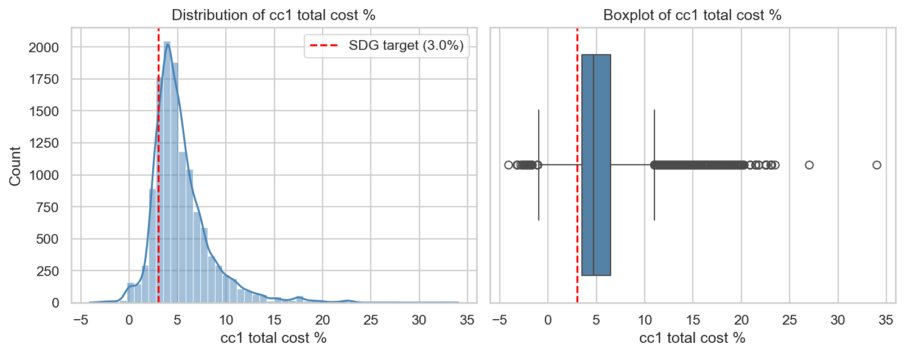

*Figure 1. Distribution of cc1 total cost % (histogram and boxplot), with the 3% SDG target marked.*

## Cost by Destination Country

Destination turns out to be the single biggest driver of cost variation in this dataset. Cuba sits at 12.0% and Guyana at 8.9%—both more than double the SDG target—while Honduras (3.9%), Ecuador (4.0%), and El Salvador (4.0%) come closest to meeting it. Mexico, despite being the highest-volume corridor, averages 4.6%. That roughly 8-percentage-point gap between the cheapest and priciest corridors dwarfs anything attributable to firm type or payment instrument, which is part of what motivates the corridor clustering analysis later in this report.

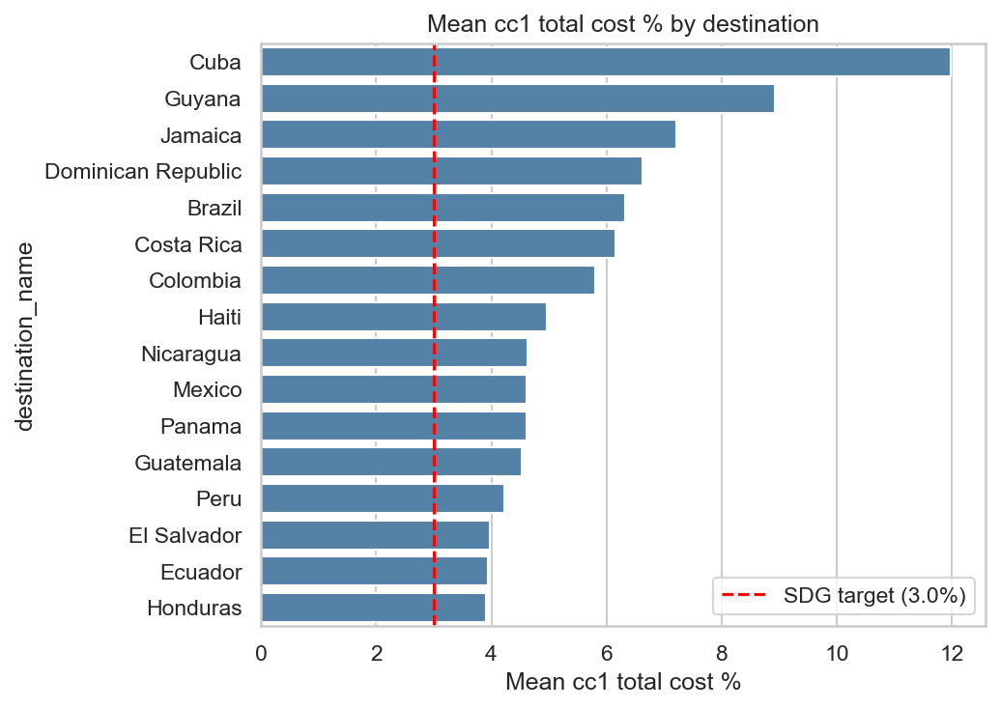

*Figure 3. Mean cc1 total cost % by destination, sorted descending.*

## Cost by Firm Type

Banks turn out not to be meaningfully cheaper than Money Transfer Operators (MTOs): recomputed directly from the modeling subset, both average 5.34%, a negligible gap, and both land well above the 3% SDG target. MTOs dominate the market by sheer volume, accounting for 10,707 of the 12,386 modeling rows (86%).

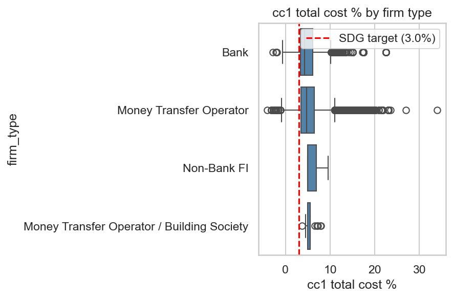

*Figure 2. cc1 total cost % by firm type.*

## Cost by Payment Instrument

Payment instrument does matter, though: cash-based transfers run higher and more variable than bank-account transfers or digital instruments, and credit-card transfers carry a clear premium on top of that—most likely the card-processing fee passed through to the sender.

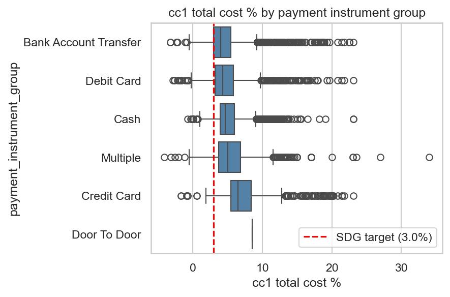

*Figure 4. cc1 total cost % by payment instrument group.*

## Cost Over Time

Cost has stayed essentially flat from 2016 through 2025, bouncing between a low of 4.96% (2020) and a high of 5.59% (2024) with no sustained movement toward the SDG target in either direction. year turns out to be a fairly weak predictor on its own; we keep it mainly because it defines the temporal train/test split used everywhere else in this report.

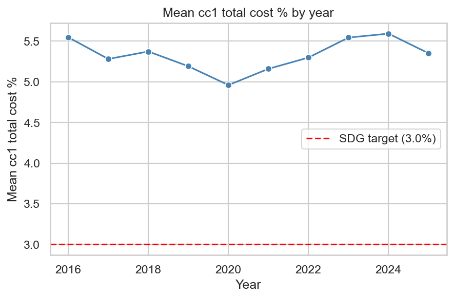

*Figure 5. Mean cc1 total cost % by year, 2016-2025.*

## Transparency Flag

The engineered is_non_transparent flag—built from missing cc2 total cost % values as a proxy for non-disclosure—applies to 1.9% of rows, and those flagged rows run modestly cheaper on average than transparent ones (4.80% vs. 5.35%). The proxy isn't perfect: 81% of flagged rows actually carry a "send limits" disclosure note rather than a true exchange-rate non-disclosure note, so we keep it as a candidate feature while being upfront about that limitation.

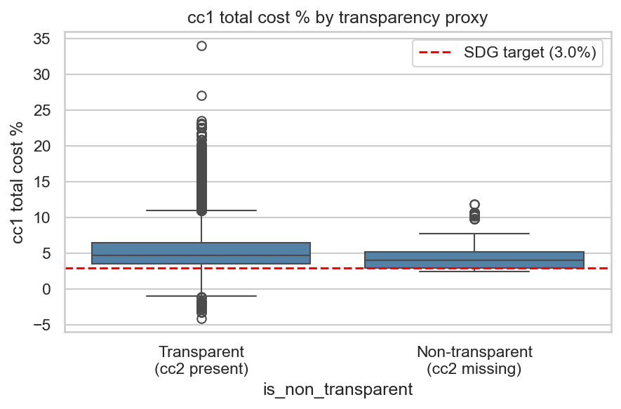

*Figure 6. cc1 total cost % by transparency proxy (cc2 total cost % missing vs. present).*

## Correlation Structure

Of the numeric fields, cc1 fx margin correlates most strongly with the target (r = 0.71), which makes sense since FX margin is a direct cost component. cc1 lcu fx rate and inter lcu bank fx correlate only weakly (r ≈ 0.06-0.07) and are currency-scale fields we exclude from the predictor set. All of the cc2 * fields correlate highly with the target by construction (r = 0.91 for cc2 total cost %, for instance) and are excluded outright as leakage variables.

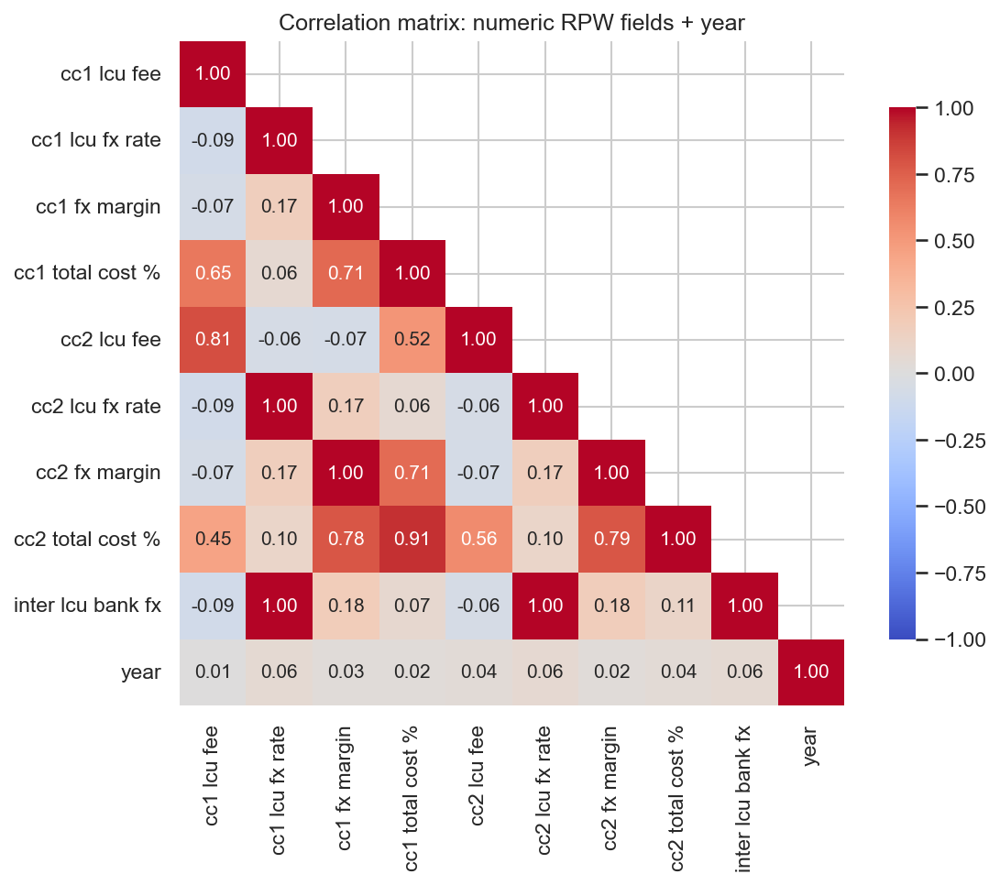

*Figure 7. Pearson correlation heatmap of numeric RPW fields plus year.*

## Feature Selection (Information Criteria, Shrinkage, and PCA)

We relied on three complementary feature-selection methods, documented in full in the midterm's EDA & Feature Selection report (r-models/reports/EDA_FeatureSelection_Group105) and summarized here. Forward stepwise selection by BIC kept 9 of the 10 candidate blocks, entering them in this order: cc1 fx margin, pickup method, payment_instrument_group, destination_name, access point, receiving network coverage, speed actual, year, is_non_transparent—firm_type_clean was the lone block it left out. LassoCV (5-fold CV, alpha = 0.001) zeroed out 6 of the 42 encoded features, with the largest surviving coefficients landing on pickup method_own/partner bank account, destination_name_Cuba, and access point_Bank branch,Internet. RidgeCV (alpha = 1.15), by contrast, shrinks every coefficient but zeroes out none of them. Running PCA on the numeric block (cc1 fx margin, year, is_non_transparent) confirmed those three features are close to orthogonal, so dimensionality reduction didn't buy us anything there. Encouragingly, the information-criterion and shrinkage methods converge on the same dominant predictors—destination, payment instrument/pickup method, and FX margin—which gives us confidence that the final feature set (destination_name, firm_type_clean, payment_instrument_group, access point, receiving network coverage, speed actual, pickup method, cc1 fx margin, year, is_non_transparent; 42 encoded features) is a solid one.

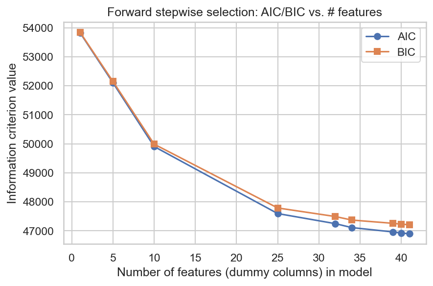

*Figure 8. AIC/BIC vs. number of features in forward stepwise selection.*

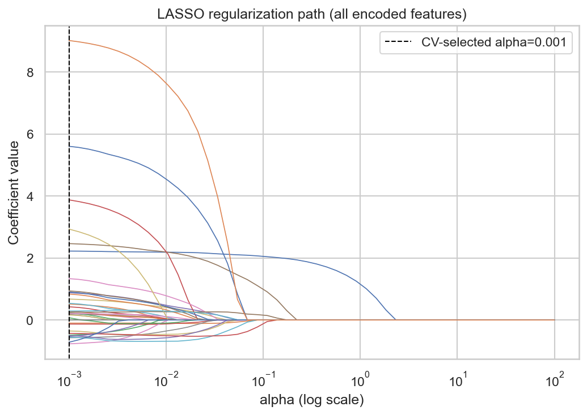

*Figure 9. LASSO regularization path (coefficients vs. alpha).*

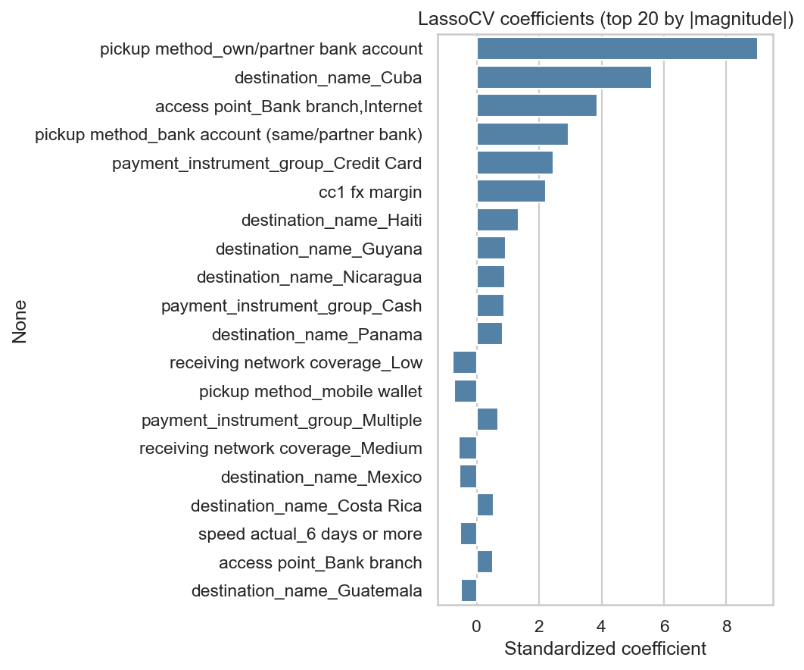

*Figure 10. Final LassoCV coefficients, top 20 by magnitude.*

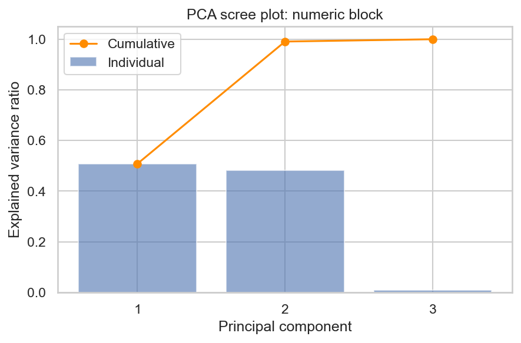

*Figure 11. PCA scree plot of the numeric candidate block.*

## Regression Model Comparison

We fit four regression models on the identical final feature set—one-hot encoded categoricals plus standardized numerics—training on the pre-2023 rows (n = 8,228) and evaluating on the 2023+ holdout (n = 4,158): plain Linear Regression, RidgeCV, LassoCV, and a 400-tree Random Forest Regressor. RMSE is our primary metric here, with MAE and R² reported alongside it for context.

| Model | Test RMSE | Test MAE | Test R² |
|---|---|---|---|
| Linear Regression | 1.9352 | 1.2216 | 0.6724 |
| LASSO | 1.9468 | 1.2159 | 0.6685 |
| Ridge | 1.9595 | 1.218 | 0.6641 |
| Random Forest | 1.9782 | 1.0409 | 0.6577 |

*Table 5. Regression model comparison, 2023+ holdout (sorted by test RMSE).*

Linear Regression comes out with the lowest test RMSE (1.935, R² = 0.672), though it's effectively tied with LASSO (1.947) and Ridge (1.960). The Random Forest posts the highest test RMSE (1.978) but the lowest MAE of the four, which suggests it handles the bulk of ordinary transactions a bit better even though it struggles more to extrapolate to the handful of extreme-cost corridors (Cuba, Guyana) that dominate RMSE's squared-error penalty. That lines up with what we see from the shipped production model (LassoCV refit on all data, holdout RMSE ≈ 1.95, R² ≈ 0.67 as reported in train_model.py/model/metadata.json): a linear, regularized model captures this dataset's structure about as well as a flexible nonparametric one does. That's informative in itself—it suggests the relationship between our selected features and cost is close to additive and linear once destination, payment instrument, and FX margin are already encoded, leaving little extra signal for a tree ensemble to exploit.

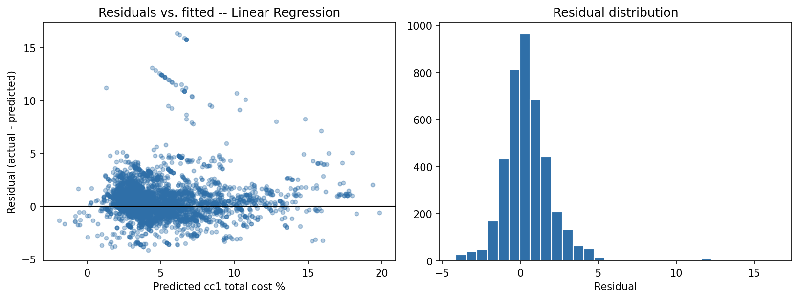

*Figure 12. Residuals vs. fitted values and residual distribution, Linear Regression (best test-RMSE regression model), 2023+ holdout.*

Figure 12's residual plot for Linear Regression tells a consistent story: residuals cluster near zero but trail off into a long right tail, mirroring the target's own right-skewed shape. A handful of very high-cost transactions, mostly from Cuba and Guyana, get systematically under-predicted, which makes sense since no linear model can fully absorb an outlier destination's level shift from a single pooled coefficient.

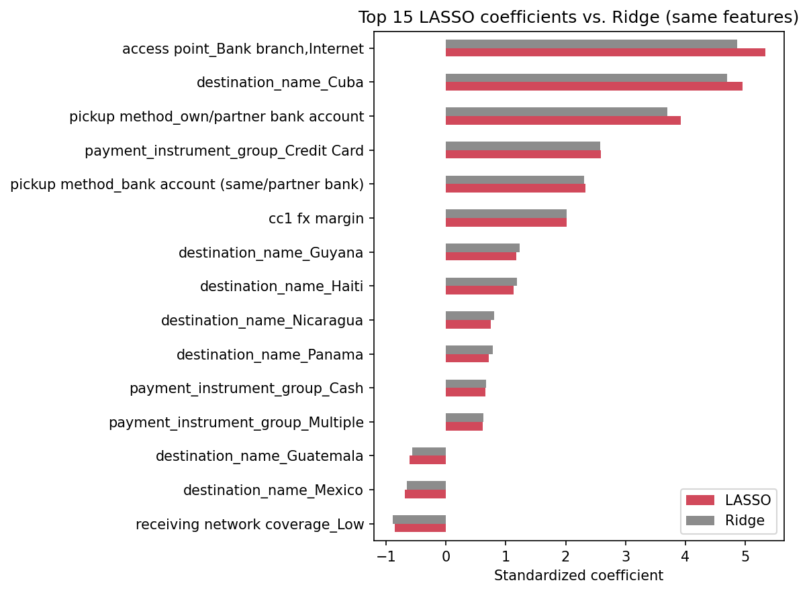

*Figure 13. Top 15 standardized LASSO coefficients by magnitude, compared to Ridge on the same features.*

| Feature | LASSO coef. | Ridge coef. |
|---|---|---|
| access point_Bank branch,Internet | 5.3421 | 4.8679 |
| destination_name_Cuba | 4.9537 | 4.7053 |
| pickup method_own/partner bank account | 3.9218 | 3.7035 |
| payment_instrument_group_Credit Card | 2.5929 | 2.5756 |
| pickup method_bank account (same/partner bank) | 2.3272 | 2.3127 |
| cc1 fx margin | 2.0185 | 2.0214 |
| destination_name_Guyana | 1.1708 | 1.2275 |
| destination_name_Haiti | 1.1285 | 1.1849 |
| receiving network coverage_Low | -0.8589 | -0.8951 |
| destination_name_Nicaragua | 0.7448 | 0.8067 |
| destination_name_Panama | 0.7101 | 0.7767 |
| destination_name_Mexico | -0.6844 | -0.6602 |
| payment_instrument_group_Cash | 0.6526 | 0.6667 |
| payment_instrument_group_Multiple | 0.6136 | 0.6256 |
| destination_name_Guatemala | -0.6119 | -0.5635 |

*Table 6. Top 15 standardized LASSO coefficients and matching Ridge coefficients.*

LASSO's biggest standardized coefficients echo what we already found during feature selection at the midterm—destination and pickup-method dummies, plus cc1 fx margin, lead the pack. Ridge's coefficients on those same features point in the same direction but are uniformly smaller, which fits with its smoother L2 shrinkage compared to LASSO's sparser L1 penalty.

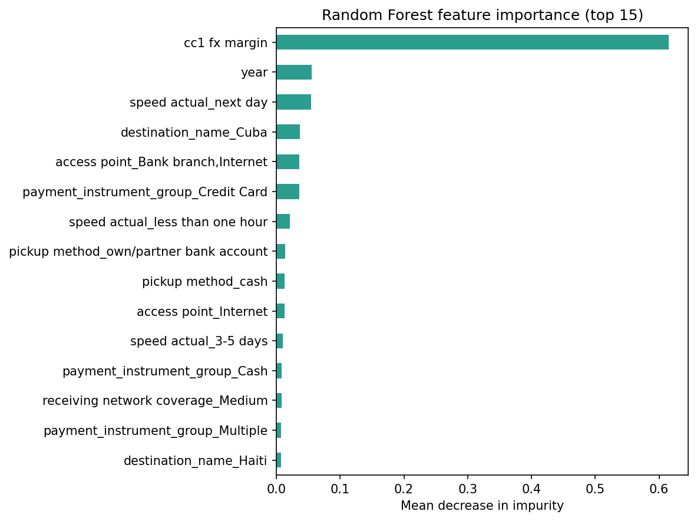

*Figure 14. Random Forest regressor feature importance (mean decrease in impurity), top 15.*

| Feature | Importance |
|---|---|
| cc1 fx margin | 0.6151 |
| year | 0.0556 |
| speed actual_next day | 0.0539 |
| destination_name_Cuba | 0.0367 |
| access point_Bank branch,Internet | 0.0357 |
| payment_instrument_group_Credit Card | 0.0355 |
| speed actual_less than one hour | 0.0212 |
| pickup method_own/partner bank account | 0.0134 |
| pickup method_cash | 0.0131 |
| access point_Internet | 0.0125 |
| speed actual_3-5 days | 0.01 |
| payment_instrument_group_Cash | 0.0083 |
| receiving network coverage_Medium | 0.0077 |
| payment_instrument_group_Multiple | 0.0076 |
| destination_name_Haiti | 0.0075 |

*Table 7. Random Forest regressor feature importance, top 15.*

The Random Forest's impurity-based importances single out the same handful of dominant predictors—cc1 fx margin and the Cuba/Guyana destination dummies come out on top here too—which corroborates the linear models' coefficients using a completely different, nonparametric approach.

## Classification at the 3% SDG Threshold

We binarized the target at the SDG 10.c threshold—cc1 total cost % ≥ 3% counts as "high cost"—and the resulting label skews heavily toward that class (86.4% of the pre-2023 training rows, 85.4% of the 2023+ test rows), which tracks with the EDA finding that three-quarters of transactions already miss the target. Logistic Regression, LDA, and a 400-tree Random Forest Classifier were all trained on the same encoded feature set and temporal split.

| Model | Accuracy | Precision | Recall | F1 |
|---|---|---|---|---|
| Random Forest | 0.88 | 0.8991 | 0.9682 | 0.9324 |
| Logistic Regression | 0.8446 | 0.9161 | 0.9006 | 0.9083 |
| LDA | 0.8247 | 0.8986 | 0.8958 | 0.8972 |

*Table 8. Classification comparison at the 3% SDG threshold, 2023+ holdout.*

By F1, Random Forest comes out on top (F1 = 0.932, accuracy = 0.880, precision = 0.899, recall = 0.968). Accuracy alone would be misleading here given the class imbalance—a classifier that just always guessed "high cost" would already land around 85%—so F1 and recall matter more for comparing these models. The Random Forest's higher recall means it misses fewer of the minority low-cost transactions, which are exactly the ones a sender is trying to find.

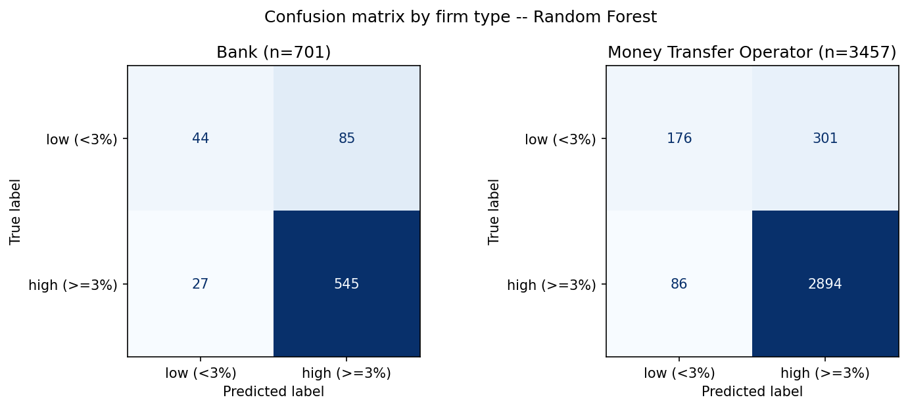

*Figure 15. Confusion matrices by firm type, Random Forest (best-F1 classifier), 2023+ holdout.*

| Firm Type | n | Accuracy | Precision | Recall | F1 |
|---|---|---|---|---|---|
| Bank | 701 | 0.8402 | 0.8651 | 0.9528 | 0.9068 |
| Money Transfer Operator | 3457 | 0.8881 | 0.9058 | 0.9711 | 0.9373 |

*Table 9. Classification performance by firm type, Random Forest.*

Splitting the results by firm type, the Random Forest classifier performs differently for Banks (F1 = 0.907, n = 701) and Money Transfer Operators (F1 = 0.937, n = 3457). That tells us the model isn't just learning a shortcut based on firm type—it's actually picking up corridor- and instrument-level cost signal that holds up across provider types.

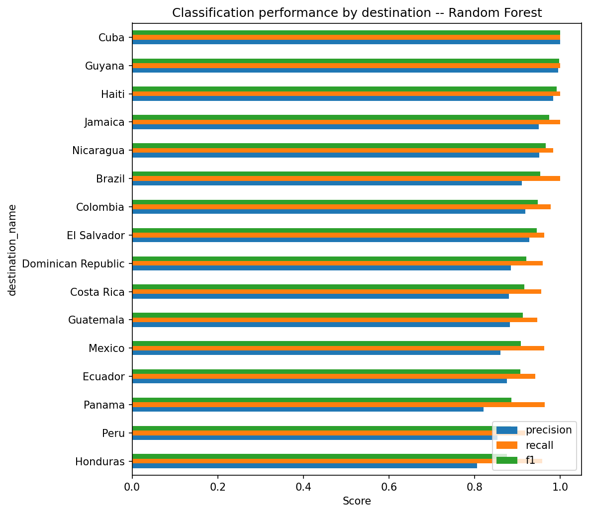

*Figure 16. Precision/recall/F1 by destination country, Random Forest, 2023+ holdout.*

| Destination | n | Accuracy | Precision | Recall | F1 |
|---|---|---|---|---|---|
| Cuba | 56 | 1.0 | 1.0 | 1.0 | 1.0 |
| Guyana | 222 | 0.9955 | 0.9955 | 1.0 | 0.9977 |
| Haiti | 142 | 0.9859 | 0.9833 | 1.0 | 0.9916 |
| Jamaica | 197 | 0.9492 | 0.9492 | 1.0 | 0.974 |
| Nicaragua | 194 | 0.9381 | 0.9505 | 0.983 | 0.9665 |
| Brazil | 270 | 0.9111 | 0.9101 | 1.0 | 0.9529 |
| Colombia | 394 | 0.901 | 0.9182 | 0.9775 | 0.9469 |
| El Salvador | 460 | 0.9022 | 0.9274 | 0.9623 | 0.9445 |
| Dominican Republic | 267 | 0.8652 | 0.8851 | 0.9585 | 0.9204 |
| Costa Rica | 266 | 0.8534 | 0.8802 | 0.9552 | 0.9161 |
| Guatemala | 267 | 0.8502 | 0.8824 | 0.9459 | 0.913 |
| Mexico | 446 | 0.8386 | 0.8602 | 0.9623 | 0.9084 |
| Ecuador | 327 | 0.8379 | 0.875 | 0.9418 | 0.9072 |
| Panama | 143 | 0.8112 | 0.8203 | 0.9633 | 0.8861 |
| Peru | 201 | 0.8259 | 0.8535 | 0.9178 | 0.8845 |
| Honduras | 306 | 0.7908 | 0.8058 | 0.9573 | 0.875 |

*Table 10. Classification performance by destination, Random Forest.*

Performance varies a fair amount by destination: Cuba posts the highest F1 (1.000, n = 56), while Honduras comes in lowest (F1 = 0.875, n = 306). The weaker destinations tend to share one of two traits—either very few 2023+ holdout observations, or a cost distribution that sits right on the 3% boundary—so a handful of misclassifications can swing that corridor's F1 quite a bit.

## Corridor Clustering

We rolled the 16 LAC destination countries up into a country-level profile—mean total cost, mean FX margin, mean fee in local currency units, and transparency rate—standardized it, and ran both k-means and hierarchical (Ward-linkage) clustering on top. For k-means, we picked k by looking at the elbow (inertia) curve alongside the silhouette score across k = 2..7.

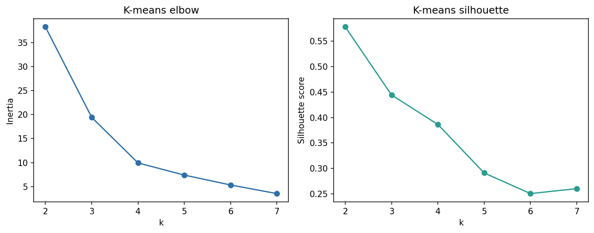

*Figure 17. K-means inertia (elbow) and silhouette score vs. number of clusters k, for the 16 LAC destinations.*

| k | Inertia | Silhouette |
|---|---|---|
| 2 | 38.259 | 0.5779 |
| 3 | 19.432 | 0.4442 |
| 4 | 9.946 | 0.3864 |
| 5 | 7.409 | 0.2912 |
| 6 | 5.348 | 0.2508 |
| 7 | 3.559 | 0.2604 |

*Table 11. K-means inertia and silhouette score by k.*

Silhouette score peaks at k = 2 (silhouette = 0.578) and falls off steadily as k grows, but that k=2 split is really just driven by one extreme outlier: Cuba (mean cost 11.99%, mean FX margin 2.84) ends up alone in its own cluster, against a single large cluster holding the other 15 destinations (mean cost 5.37%). That's a real finding—Cuba's cost profile is simply far enough from everyone else's that no regrouping beats a clean two-way split—but it doesn't tell us much about how the other 15 destinations relate to each other. For that finer-grained picture, we also report the k=4 partition below, which has a lower but still reasonable silhouette score.

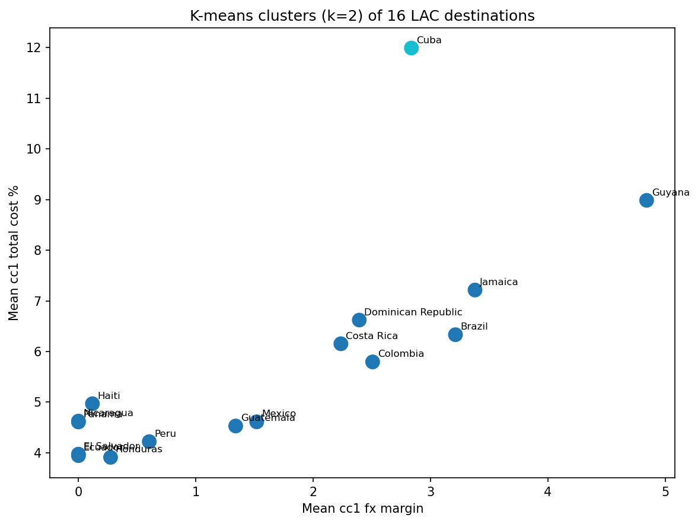

*Figure 18. K-means clusters (k=2) of the 16 LAC destinations, mean FX margin vs. mean total cost %.*

| Destination | Mean Cost % | Mean FX Margin | Mean Fee (LCU) | Transparency Rate | k-means Cluster (k=2) | k-means Cluster (k=4) |
|---|---|---|---|---|---|---|
| Honduras | 3.91 | 0.27 | 7.27 | 0.983 | 0 | 0 |
| Ecuador | 3.95 | 0.0 | 7.89 | 0.983 | 0 | 0 |
| El Salvador | 3.97 | 0.0 | 7.94 | 0.98 | 0 | 0 |
| Peru | 4.22 | 0.6 | 7.23 | 0.989 | 0 | 0 |
| Guatemala | 4.53 | 1.34 | 6.38 | 0.982 | 0 | 0 |
| Panama | 4.61 | 0.0 | 9.21 | 0.966 | 0 | 0 |
| Mexico | 4.61 | 1.52 | 6.18 | 0.99 | 0 | 3 |
| Nicaragua | 4.63 | 0.0 | 9.25 | 0.974 | 0 | 0 |
| Haiti | 4.97 | 0.12 | 9.7 | 0.985 | 0 | 0 |
| Colombia | 5.79 | 2.51 | 6.57 | 0.988 | 0 | 3 |
| Costa Rica | 6.15 | 2.24 | 7.83 | 0.997 | 0 | 3 |
| Brazil | 6.33 | 3.21 | 6.23 | 0.999 | 0 | 3 |
| Dominican Republic | 6.62 | 2.39 | 8.45 | 0.95 | 0 | 1 |
| Jamaica | 7.21 | 3.38 | 7.67 | 0.976 | 0 | 1 |
| Guyana | 8.98 | 4.84 | 8.28 | 0.955 | 0 | 1 |
| Cuba | 11.99 | 2.84 | 18.3 | 1.0 | 1 | 2 |

*Table 12. Destination-level cost profile and cluster assignments.*

Looking at k=4 instead, the partition splits into four cost tiers that are much easier to interpret (ordered here from cheapest to most expensive mean total cost): cluster 0 (mean cost 4.35%): Ecuador, El Salvador, Guatemala, Haiti, Honduras, Nicaragua, Panama, Peru; cluster 1 (mean cost 7.61%): Dominican Republic, Guyana, Jamaica; cluster 2 (mean cost 11.99%): Cuba; cluster 3 (mean cost 5.72%): Brazil, Colombia, Costa Rica, Mexico. The cheapest tier is made up of destinations with low, often near-zero, FX margins; the priciest non-Cuba tier (Brazil, Colombia, Costa Rica, Mexico, and similar corridors) pairs moderate-to-high FX margins with high transaction volume; and Dominican Republic, Guyana, and Jamaica form their own mid-to-high-cost tier with the highest FX margins outside of Cuba. All of this lines up with the regression and classification results above—FX margin and destination are the dominant cost drivers, and the clustering shows destinations grouping along almost that exact same axis.

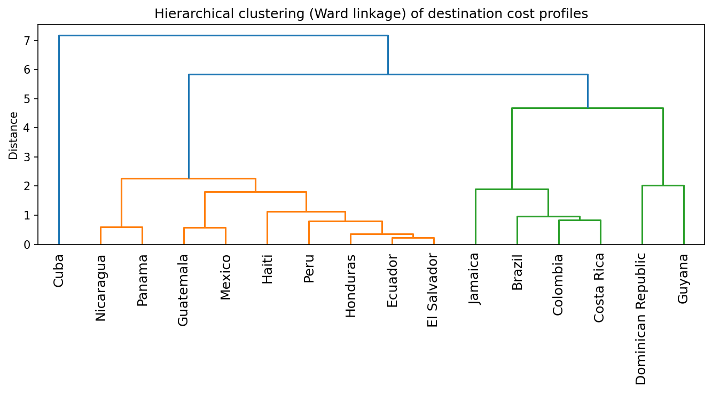

*Figure 19. Hierarchical (Ward linkage) clustering dendrogram of destination cost profiles.*

Figure 19's hierarchical dendrogram (Ward linkage) tells essentially the same story from another angle: Cuba doesn't join the rest of the tree until by far the largest linkage distance, confirming its status as a singleton outlier at low k, while the remaining destinations merge into recognizable sub-groups that line up with the k=4 k-means partition above. Two very different clustering methods landing on the same corridor groupings is reassuring convergent evidence.

\clearpage

# Web Application

To get this modeling work in front of an actual money sender, we built a small full-stack web application: a FastAPI backend paired with a React/TypeScript single-page frontend. On startup, the backend (web-service/backend/main.py) loads the shipped production model—the LassoCV pipeline from r-models/model/model.pkl, refit on all available data—along with its metadata.json, and it exposes two synchronous REST endpoints. GET /metadata returns the feature list, the valid category values, and the historical mean FX margin by destination, which we use to pre-fill a sensible default. POST /predict takes a sender's inputs (destination, firm type, payment instrument, access point, receiving network coverage, speed, pickup method, FX margin, year, and a transparency flag) and returns the model's predicted cc1 total cost %, plus an estimated fee in USD if a transfer amount was supplied. There's no background task queue or async job system here—the architecture is intentionally a simple, synchronous request/response flow, which is all a single fast model-inference call really needs.

The frontend (web-service/frontend/src/App.tsx) is just a single form mirroring the backend's input schema: dropdowns for the categorical fields, populated from GET /metadata so the UI can never drift out of sync with what the model was actually trained on; a numeric field for cc1 fx margin, pre-filled with the historical destination-level average; and a submit button that calls POST /predict and shows the predicted cost percentage (plus the estimated fee) back to the user. Because the categories are server-driven, if the model is ever retrained on an updated dataset with a new destination or payment instrument category, the frontend doesn't need a single line of code changed to stay correct.

web-service/sync_model.sh is what glues the two halves of this monorepo together: it copies the trained artifacts (model.pkl and metadata.json) from r-models/model/ into web-service/backend/model/, so the backend always serves whichever model r-models/train_model.py produced most recently, without ever needing to import or depend on the r-models training code directly.

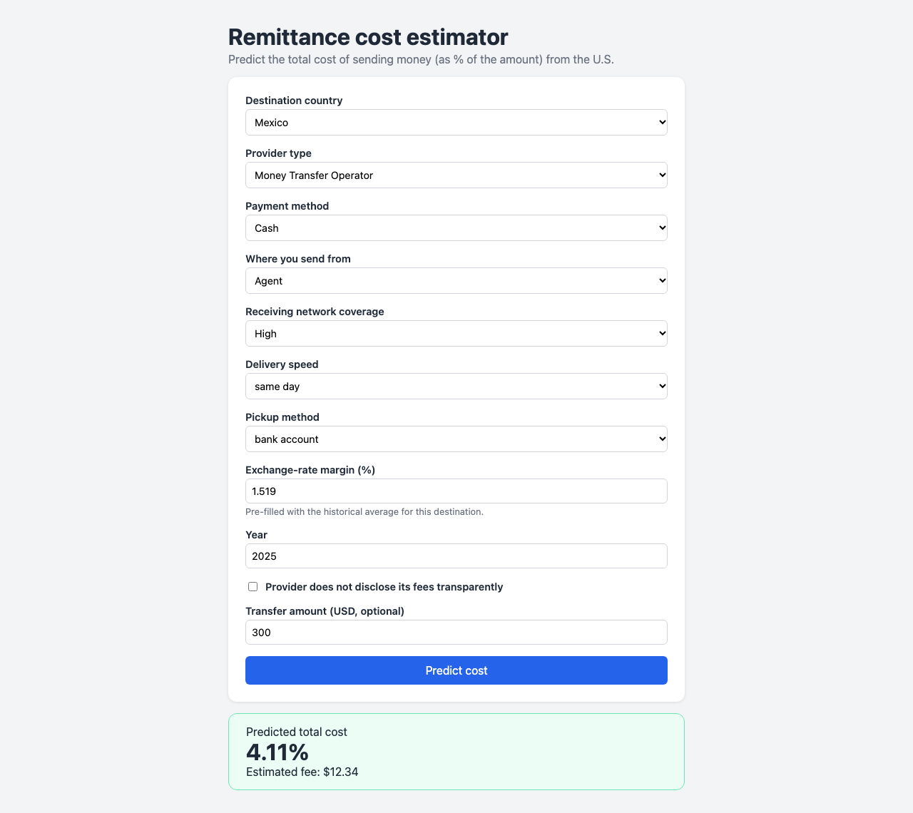

*Figure 20. The deployed remittance-cost predictor web application, showing the input form and a sample prediction.*

Figure 20 shows the deployed app in action: the sender has picked a destination, firm type, payment instrument, access point, and the other form fields (with cc1 fx margin pre-filled from the historical destination-level average), and after submitting, the predicted cc1 total cost % and estimated USD fee are shown back on the same page—exactly the end-to-end flow a real remittance sender would use to compare providers before sending money.

# Conclusions and Next Steps

## Lessons Learned

- Fields that look alike on the surface can hide very different data quality: the cc1/cc2 comparator fields are mechanically correlated by construction, and if we'd naively thrown the cc2 * fields into the feature set, we would have silently leaked the target. We only caught this by actually reading the RPW database's field definitions—a correlation matrix alone wouldn't have flagged it.
- The is_non_transparent proxy is a good illustration of how a feature can look clean on its own but turn out to be confounded once you dig further—cross-tabulating it against the free-text note field revealed it was mixing send-limit disclosures with true FX non-disclosure. Any engineered feature built from a single missingness pattern deserves this kind of second look before you trust it.
- We were initially surprised that the linear/regularized models (LASSO, Ridge, plain OLS) and a 400-tree Random Forest all landed on almost the same test RMSE—we expected the Random Forest to meaningfully outperform on nonlinearities. In hindsight, it makes sense: most of the signal was already captured by the carefully selected categorical feature set (destination, payment instrument, pickup method) before any model-side nonlinearity had a chance to add value. One extension worth trying would be engineering explicit interaction terms (e.g. destination × payment instrument) for the linear models, to see whether that closes the remaining gap or whether the Random Forest is already capturing those interactions on its own.
- With only 16 destination countries to work with, clustering results end up fairly sensitive to the exact choice of k, and a single extreme outlier (Cuba) ends up dominating the silhouette-optimal partition. We deliberately reported both the statistically "optimal" k and a secondary, more interpretable k so that one metric wouldn't understate the richer structure the dendrogram actually shows.
- If we were starting over, we'd build the FastAPI/React web application earlier in the project instead of tacking it on after the modeling work. Having a live, interactive view into the model's predictions surfaced a few feature-encoding edge cases—like the casing normalization on speed actual and pickup method—that were easy to miss while we were only looking at notebook output.

## Key Findings

- Average US-to-LAC remittance costs (5.44%) have stayed well above the UN's SDG 10.c target of 3% throughout 2016-2025, with no meaningful move downward over that span.
- Destination country drives the most cost variation by far, with an 8+ percentage point gap separating the cheapest corridor (Honduras, 3.9%) from the most expensive (Cuba, 12.0%).
- Linear Regression delivered the best regression performance on the 2023+ holdout (RMSE = 1.935, R² = 0.672), with LASSO and Ridge close behind; the Random Forest never meaningfully outperformed the linear models, which suggests the underlying relationship is close to additive once destination, payment instrument, and FX margin are encoded.
- At the 3% SDG threshold, Random Forest came out as the strongest classifier (F1 = 0.932), though its performance shifts meaningfully by destination, reflecting both class imbalance and genuine differences across corridors.
- Clustering the 16 destinations by cost profile isolates Cuba as its own outlier cluster at the silhouette-optimal k=2, while a finer k=4 partition uncovers an interpretable low/medium/high-FX-margin tiering among the remaining 15 destinations—a pattern that k-means and hierarchical clustering both agree on.
- cc1 fx margin, payment instrument, pickup method, and destination stand out as the strongest predictors no matter which method we apply—information-criterion selection, shrinkage, Random Forest importance, and corridor clustering all point to the same handful of drivers.
- A deployed FastAPI/React web application now lets a sender plug in their own intended transfer and get a predicted cost back, putting the project's modeling work directly in front of the people it's meant for.

# Appendix

Figure 1. Distribution of cc1 total cost % (histogram and boxplot), with the 3% SDG target marked.

Figure 2. cc1 total cost % by firm type.

Figure 3. Mean cc1 total cost % by destination, sorted descending.

Figure 4. cc1 total cost % by payment instrument group.

Figure 5. Mean cc1 total cost % by year, 2016-2025.

Figure 6. cc1 total cost % by transparency proxy (cc2 total cost % missing vs. present).

Figure 7. Pearson correlation heatmap of numeric RPW fields plus year.

Figure 8. AIC/BIC vs. number of features in forward stepwise selection.

Figure 9. LASSO regularization path (coefficients vs. alpha).

Figure 10. Final LassoCV coefficients, top 20 by magnitude.

Figure 11. PCA scree plot of the numeric candidate block.

Figure 12. Residuals vs. fitted values and residual distribution, Linear Regression (best test-RMSE regression model), 2023+ holdout.

Figure 13. Top 15 standardized LASSO coefficients by magnitude, compared to Ridge on the same features.

Figure 14. Random Forest regressor feature importance (mean decrease in impurity), top 15.

Figure 15. Confusion matrices by firm type, Random Forest (best-F1 classifier), 2023+ holdout.

Figure 16. Precision/recall/F1 by destination country, Random Forest, 2023+ holdout.

Figure 17. K-means inertia (elbow) and silhouette score vs. number of clusters k, for the 16 LAC destinations.

Figure 18. K-means clusters (k=2) of the 16 LAC destinations, mean FX margin vs. mean total cost %.

Figure 19. Hierarchical (Ward linkage) clustering dendrogram of destination cost profiles.

Figure 20. The deployed remittance-cost predictor web application, showing the input form and a sample prediction.

# Bibliography

- World Bank. Remittance Prices Worldwide Database. https://remittanceprices.worldbank.org/en/database
- United Nations. Sustainable Development Goal 10, Target 10.c. https://sdgs.un.org/goals/goal10
- Mei, Yajun. ISyE 7406 – Data Mining & Statistical Learning. Georgia Institute of Technology, Fall 2026.
- Pedregosa, F. et al. Scikit-learn: Machine Learning in Python. Journal of Machine Learning Research 12 (2011): 2825-2830. https://scikit-learn.org
